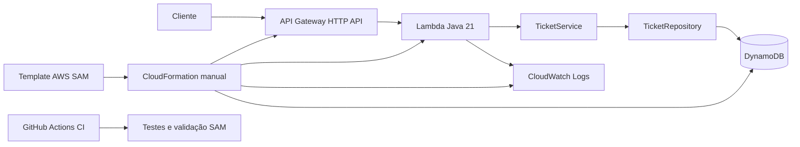
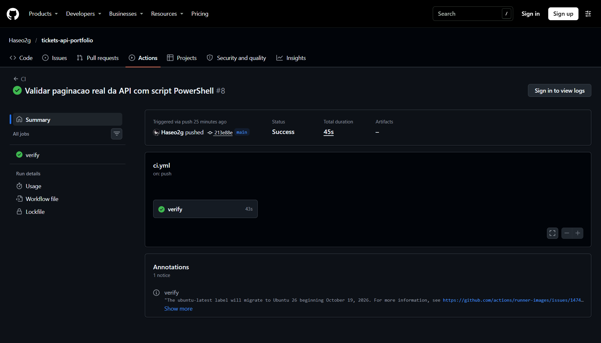
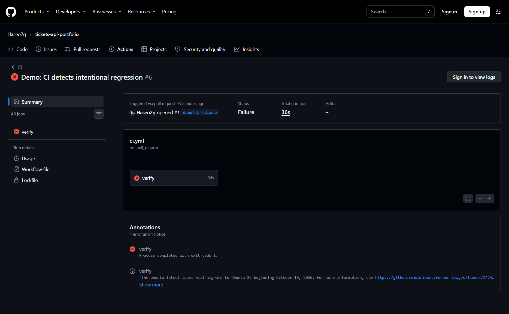
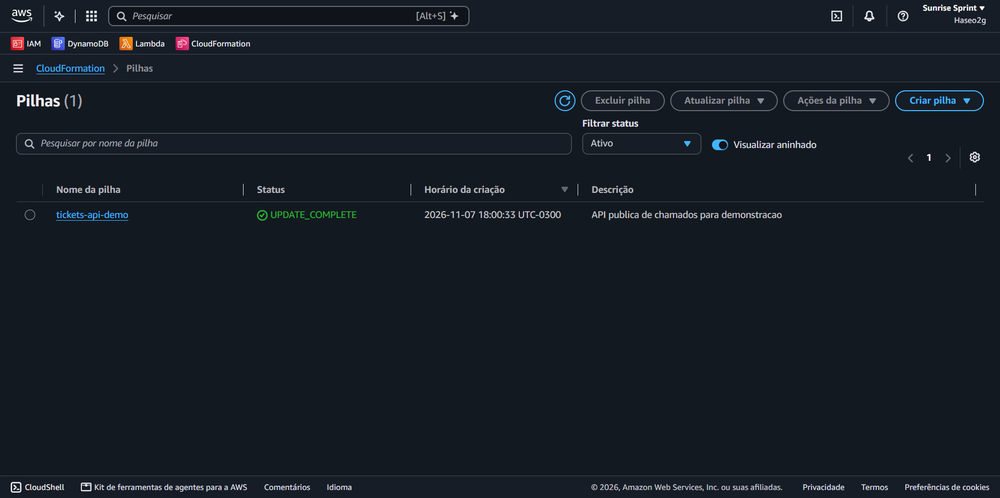
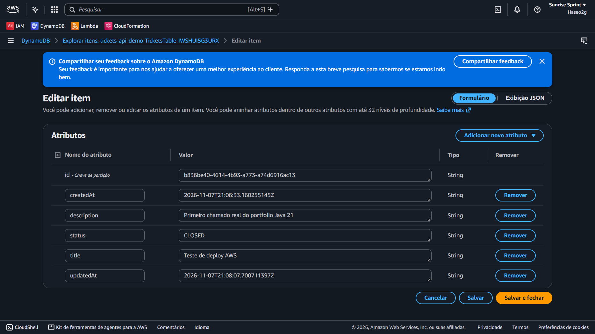
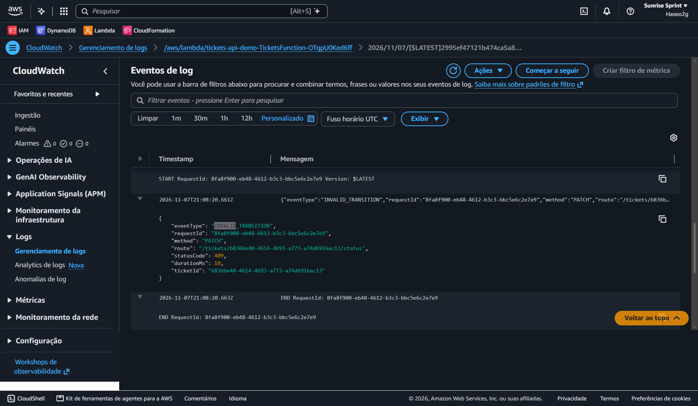

# API de chamados em Java 21 na AWS

API pública de gerenciamento de chamados para demonstrar Java, regras de negócio, DynamoDB, tratamento de erros, logs estruturados, testes e integração contínua. A aplicação foi **publicada manualmente** com AWS SAM e CloudFormation na região `us-east-2`. Use somente **dados fictícios**: esta versão não tem autenticação.

**[API publicada](https://k9okaxkcpg.execute-api.us-east-2.amazonaws.com/health)** · **[CI aprovada](https://github.com/Haseo2g/tickets-api-portfolio/actions/runs/42421693938)** · **[Template SAM](template.yaml)** · **[Deploy manual](docs/DEPLOY_MANUAL_AWS_FREE.md)**

## Estado e evidências

| Etapa | Resultado |
|---|---|
| Aplicação | Java 21, cinco rotas e persistência no DynamoDB |
| Testes unitários | 6 testes aprovados antes da publicação; executáveis sem conta AWS |
| CI | [Execução no GitHub Actions](https://github.com/Haseo2g/tickets-api-portfolio/actions/runs/42421693938) aprovada no commit `213e88e`: Maven Wrapper, testes, pacote e `sam validate` em `us-east-2` |
| Demonstração de falha | [PR #1](https://github.com/Haseo2g/tickets-api-portfolio/pull/1) fechado sem merge; [CI reprovada pelo teste intencional](https://github.com/Haseo2g/tickets-api-portfolio/actions/runs/42420319459) |
| Paginação na AWS | [Teste real em 07/11/2026](docs/evidence/pagination-2026-11-07.json): 5 chamados criados, 4 páginas com `limit=2`, todos encontrados e nenhum ID duplicado nessa execução |
| AWS | Stack `tickets-api-demo` publicada pelo **console CloudFormation** na conta `161513061416`, região `us-east-2`; captura do console mostra `UPDATE_COMPLETE` |
| Deploy por GitHub Actions | Pendente: OIDC no IAM está bloqueado no Free Account Plan informado; o workflow `Deploy` existe, mas não foi utilizado |

As capturas de CI, CloudFormation, DynamoDB e CloudWatch aparecem nas seções relacionadas. O [registro de evidências](docs/EVIDENCIAS_EXECUCAO.md) separa os testes automatizados, as respostas HTTP e as capturas do console.

## Arquitetura



Uma Lambda atende todas as rotas. `ApiHandler` cuida de HTTP, JSON, respostas e logs; `TicketService` aplica as regras; `Ticket` representa o domínio; `DynamoTicketRepository` implementa a interface de persistência. O cliente AWS SDK for Java v2 é reutilizado entre invocações quentes. O nome da tabela vem de `TABLE_NAME`. Maven monta o ZIP; JUnit 5 e Mockito cobrem o comportamento sem AWS nos testes. Não há Spring, containers, VPC, NAT ou domínio próprio.

## API e regras

Base URL: `https://k9okaxkcpg.execute-api.us-east-2.amazonaws.com`. Ela pode deixar de responder quando a stack for removida.

| Rota | Resposta principal |
|---|---|
| `POST /tickets` | 201; cria com status `OPEN` e UUID gerado pela aplicação |
| `GET /tickets` | 200; `limit` de 1 a 50 (padrão 20) e `nextToken` |
| `GET /tickets/{id}` | 200 ou 404 |
| `PATCH /tickets/{id}/status` | 200, 404 ou 409 |
| `GET /health` | 200; sem acesso ao banco |

`title` e `description` são obrigatórios, com limites de 120 e 2.000 caracteres. Espaços nas pontas são removidos. O JSON precisa ser válido e conter somente os campos previstos. Datas de criação e atualização usam UTC. As únicas transições são `OPEN → IN_PROGRESS → CLOSED`. A atualização condicional no DynamoDB exige que o item exista e mantenha o status lido, evitando recriação acidental e colisões concorrentes.

A listagem usa `Scan` para manter o projeto pequeno: não há ordenação garantida nem snapshot estável entre páginas. O custo de leitura cresce com o volume; uma aplicação maior precisaria modelar consultas e chaves de acesso.

Em 07/11/2026, o [script de paginação](scripts/test-pagination.ps1) percorreu a API publicada com `limit=2`. Encontrou os 5 chamados fictícios criados, sem IDs duplicados; as 4 páginas tiveram `2, 2, 2 e 0` itens. A última página vazia encerrou a navegação. Esse resultado vale para **a execução observada**: `Scan` não garante ausência de duplicações se a tabela mudar durante a leitura. O [relatório gerado](docs/evidence/pagination-2026-11-07.json) e o [registro de evidências](docs/EVIDENCIAS_EXECUCAO.md) guardam os IDs e as verificações.

Para repetir (cada execução cria mais 5 chamados fictícios; não remove dados):

```powershell
pwsh -NoProfile -File scripts/test-pagination.ps1 -BaseUrl 'https://k9okaxkcpg.execute-api.us-east-2.amazonaws.com'
```

## Respostas HTTP reais

As respostas abaixo foram observadas na API publicada. Em 07/11/2026, uma nova consulta somente de leitura a `GET /tickets` retornou HTTP 200 com os seis chamados fictícios e `nextToken: null`. O exemplo compacto omite quatro registros e os demais campos dos dois exibidos; a [resposta completa](docs/evidence/tickets-list-2026-11-07.json) preserva todos os valores.

`GET /health` — HTTP 200:

```json
{"status":"ok"}
```

`GET /tickets` — HTTP 200, trecho da resposta:

```json
{
  "items": [
    {"id":"9c78f27f-52dd-4cfd-8b01-677e0a9d743c","status":"OPEN"},
    {"id":"b836be40-4614-4b93-a773-a74d6916ac13","status":"CLOSED"}
  ],
  "nextToken": null
}
```

`GET /tickets?limit=2` — HTTP 200; resposta de página fornecida pelo proprietário após o [teste de paginação](docs/evidence/pagination-2026-11-07.json):

```json
{
  "items": [
    {
      "id": "9c78f27f-52dd-4cfd-8b01-677e0a9d743c",
      "title": "pagination-20261107T223826Z-2eab2b12-1",
      "description": "Chamado fictício para validação de paginação do portfólio.",
      "status": "OPEN",
      "createdAt": "2026-11-07T22:38:24.651283894Z",
      "updatedAt": "2026-11-07T22:38:24.651283894Z"
    },
    {
      "id": "ac51067f-ef36-4eae-9802-31889b7e0dcd",
      "title": "pagination-20261107T223826Z-2eab2b12-3",
      "description": "Chamado fictício para validação de paginação do portfólio.",
      "status": "OPEN",
      "createdAt": "2026-11-07T22:38:28.236737309Z",
      "updatedAt": "2026-11-07T22:38:28.236737309Z"
    }
  ],
  "nextToken": "YWM1MTA2N2YtZWYzNi00ZWFlLTk4MDItMzE4ODliN2UwZGNk"
}
```

`nextToken` é um cursor opaco: envie seu valor, codificado para URL, na consulta seguinte. O `Scan` não promete a mesma ordem nem um snapshot entre consultas.

`GET /tickets/b836be40-4614-4b93-a773-a74d6916ac13` — HTTP 200:

```json
{
  "id": "b836be40-4614-4b93-a773-a74d6916ac13",
  "title": "Teste de deploy AWS",
  "description": "Primeiro chamado real do portfolio Java 21",
  "status": "CLOSED",
  "createdAt": "2026-11-07T21:06:33.160255145Z",
  "updatedAt": "2026-11-07T21:08:07.700711397Z"
}
```

`PATCH /tickets/{id}/status` — HTTP 409 após tentar `CLOSED → OPEN`:

```json
{
  "error": {
    "requestId": "8fa8f900-eb48-4612-b3c3-bbc5e6c2e7e9",
    "message": "Transição de status não permitida",
    "code": "INVALID_TRANSITION"
  }
}
```

O mesmo `requestId` aparece no evento JSON do CloudWatch mostrado abaixo.

### Chamadas reproduzíveis

No PowerShell, use dados fictícios:

```powershell
$baseUrl = "https://k9okaxkcpg.execute-api.us-east-2.amazonaws.com"
Invoke-RestMethod "$baseUrl/health"

$body = @{ title = "Exemplo fictício"; description = "Chamado de demonstração" } | ConvertTo-Json
$ticket = Invoke-RestMethod "$baseUrl/tickets" -Method POST -ContentType "application/json" -Body $body
$id = $ticket.id

Invoke-RestMethod "$baseUrl/tickets/$id"
Invoke-RestMethod "$baseUrl/tickets?limit=10"
Invoke-RestMethod "$baseUrl/tickets/$id/status" -Method PATCH -ContentType "application/json" -Body '{"status":"IN_PROGRESS"}'
Invoke-RestMethod "$baseUrl/tickets/$id/status" -Method PATCH -ContentType "application/json" -Body '{"status":"CLOSED"}'
```

Criação retorna o chamado com `id`, `title`, `description`, `status`, `createdAt` e `updatedAt`. Veja também [requisições editáveis](requests.http) e [evidências detalhadas](docs/EVIDENCIAS_EXECUCAO.md). Erros incluem `x-request-id` no cabeçalho. Entrada inválida retorna 400; chamado ausente, 404; transição proibida ou conflito concorrente, 409; falha inesperada, 500. Detalhes internos e stack traces não são enviados ao cliente.

## Testes e CI

Pré-requisitos locais: JDK 21 e acesso ao Maven Central na primeira execução. O Maven Wrapper baixa Maven 3.9.16.

```powershell
./mvnw.cmd -B clean verify
```

Em Linux/macOS: `bash ./mvnw -B clean verify`. Os testes não exigem AWS, Docker ou DynamoDB Local. Maven Shade gera `target/tickets-api.jar`; Maven Assembly coloca o JAR em `lib/` dentro de `deploy-artifacts/tickets-api-lambda.zip`. Artefatos locais são ignorados pelo Git. A CI roda em push na `main` e em pull requests; configura Java 21, executa o Wrapper e valida o SAM. Ela **não publica** na AWS.



*CI aprovada no [commit `213e88e`](https://github.com/Haseo2g/tickets-api-portfolio/actions/runs/42421693938), incluindo testes, pacote e validação do template SAM.*

### Demonstração de falha no CI

Na branch temporária `demo/ci-failure`, o commit `c552a86` adicionou somente `CiFailureDemoTest.demoCiDetectsWrongInitialStatusExpectation`. O teste exige intencionalmente `CLOSED` para um chamado novo; a regra correta devolve `OPEN`. O [PR #1](https://github.com/Haseo2g/tickets-api-portfolio/pull/1), direcionado à `main`, disparou o [Actions reprovado](https://github.com/Haseo2g/tickets-api-portfolio/actions/runs/42420319459): `mvnw verify` executou **7 testes, 1 falha**, com `expected: <CLOSED> but was: <OPEN>`. Os 6 testes originais passaram. O PR foi **fechado sem merge** e a branch remota foi mantida como evidência; o teste defeituoso não está na `main`.



*O resumo da execução mostra a reprovação. A causa específica, `expected: <CLOSED> but was: <OPEN>`, está no [log do Actions](https://github.com/Haseo2g/tickets-api-portfolio/actions/runs/42420319459) e no registro de evidências.*

Em 07/11/2026, a API do GitHub informou que a `main` **não tinha branch protection nem ruleset aplicável exigindo checks aprovados**. Portanto, a execução comprova detecção pelo CI e a decisão de não integrar o defeito; **não comprova bloqueio técnico do botão de merge**. Veja o [registro da demonstração](docs/EVIDENCIAS_EXECUCAO.md).

## Infraestrutura, deploy manual e IAM

O [template SAM](template.yaml) descreve uma Lambda Java 21, uma HTTP API, uma tabela DynamoDB sob demanda, um grupo de logs com retenção de sete dias e permissões de execução restritas à tabela. O ZIP foi enviado manualmente ao bucket privado `haseo2g-tickets-api-artifacts-2026` como `tickets-api-lambda.zip`. O template carregado no console CloudFormation apontava para esse objeto S3 real; o template fonte do repositório mantém um `CodeUri` local para build e empacotamento.

A publicação usou a role de serviço `TicketsApiCloudFormationDeployRole` e a política personalizada `TicketsApiCloudFormationDeployRolePolicy`, criadas manualmente. Essa role administra os recursos da stack; a **role de execução da Lambda**, gerada pelo SAM, é outra role e só recebe as ações DynamoDB definidas no template e as permissões básicas de logs. A política de publicação não é de privilégio mínimo absoluto: operações do API Gateway com ID gerado exigiram escopo regional mais amplo.

Na criação inicial, eventos de autorização exigiram três ajustes: `cloudformation:CreateChangeSet` para o transform `Serverless-2016-10-31`, `apigateway:POST` para tags da HTTP API e `apigateway:TagResource` para o stage. Após os ajustes, a recuperação/atualização da stack foi informada como `UPDATE_COMPLETE`. Eram permissões de implantação, não defeitos do Java. Veja o [histórico e procedimento manual](docs/DEPLOY_MANUAL_AWS_FREE.md).



*Stack `tickets-api-demo` em `UPDATE_COMPLETE` no console CloudFormation. O deploy foi manual, após ajustes de permissões IAM.*

O workflow [Deploy](.github/workflows/deploy.yml) permanece disponível só por acionamento manual e requer OIDC. Ele **não foi usado** nesta publicação; o bloqueio do provedor OIDC no Free Account Plan mantém a automação pendente. Não há chaves AWS no repositório ou no workflow.

## Persistência e observabilidade

O chamado fictício `b836be40-4614-4b93-a773-a74d6916ac13` aparece no console DynamoDB com status `CLOSED` e `updatedAt` posterior a `createdAt`. A captura mostra a tela **Editar item**; a resposta HTTP acima mostra o mesmo registro.



*Registro persistido e atualizado no DynamoDB.*

Abra CloudWatch Logs e procure o grupo com prefixo `/aws/lambda/tickets-api-demo-TicketsFunction-`. Cada requisição produz JSON com `eventType`, `requestId`, `method`, `route`, `statusCode`, `durationMs` e, quando aplicável, `ticketId`. Pesquise pelo `requestId` devolvido no erro ou no cabeçalho `x-request-id` para encontrar a requisição. Não são registrados corpos completos, descrições ou credenciais. Linhas `START`, `END` e `REPORT` são emitidas pela plataforma Lambda.



*O evento JSON mostra `statusCode=409` e o mesmo `requestId` da resposta HTTP, permitindo investigar a falha sem registrar o corpo da requisição. Uma [visão geral dos logs](docs/images/cloudwatch-logs.png) também está disponível.*

## Segurança, custo e remoção

A API é pública e **não possui autenticação**; CORS não resolve isso. Use exclusivamente dados fictícios. O throttling da HTTP API (5 req/s, burst 10) e a concorrência reservada da Lambda (2) reduzem picos, mas não estabelecem um teto de gasto. A gratuidade depende de créditos, prazo, limites e uso da conta Free Account Plan. Confira a cobrança e remova o ambiente depois da apresentação.

Para remover, exclua a stack `tickets-api-demo` no CloudFormation em `us-east-2` e espere `DELETE_COMPLETE`. A tabela usa `DeletionPolicy: Delete`: **seus dados serão apagados**. Confirme a remoção da Lambda, API, log group e role de execução. Esvazie e exclua separadamente o bucket de artefatos **somente se ele for exclusivo do projeto**; trate versões e delete markers se houver versionamento. Revise também o bucket auxiliar do CloudFormation e a role de publicação, criados fora da stack, antes de removê-los. O [guia manual](docs/DEPLOY_MANUAL_AWS_FREE.md) detalha o procedimento.

Para voltar a uma versão anterior do código, use `git revert` ou um checkout controlado do commit desejado, execute a CI e faça uma **nova publicação manual** após revisar template e artefato. Voltar o código **não restaura dados** do DynamoDB.

Limitações proporcionais ao projeto: `Scan` sem ordenação ou snapshot, API pública e ausência de busca/filtros. Melhorias futuras: autenticação, consultas modeladas por chave e métricas/alertas se houver uso que justifique custo.

## Demonstração em cerca de cinco minutos

1. **0:00–0:45** — Mostre este README, a arquitetura e a URL da API.
2. **0:45–1:30** — Mostre os testes locais e a [CI aprovada](https://github.com/Haseo2g/tickets-api-portfolio/actions/runs/42421693938).
3. **1:30–2:30** — Execute `GET /health`, consulte o chamado fictício e explique `OPEN → IN_PROGRESS → CLOSED`.
4. **2:30–3:30** — Mostre o item no DynamoDB e a resposta 409 para transição proibida.
5. **3:30–4:15** — Correlacione `requestId` da resposta com o JSON no CloudWatch.
6. **4:15–5:00** — Explique o deploy manual, a separação das roles, custo e remoção.

## Referências

- [Guia de deploy manual e fontes oficiais AWS](docs/DEPLOY_MANUAL_AWS_FREE.md)
- [Contrato de requisições](requests.http)
- [Resultados informados e evidências](docs/EVIDENCIAS_EXECUCAO.md)
