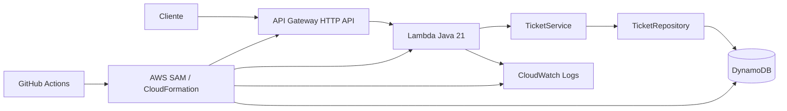

# API de chamados em Java na AWS

Projeto de portfólio: uma API pública pequena, com regras de negócio, persistência, testes e entrega automatizada. Use **somente dados fictícios**. Não há autenticação nesta versão; CORS não é autenticação.

## Estado atual

| Etapa | Estado |
|---|---|
| Implementação Java, testes, template SAM e workflows | Concluídos no código |
| Testes e pacote locais | `./mvnw.cmd -B verify` em 07/11/2026: **6 testes, 0 falhas, BUILD SUCCESS**; JAR gerado em `target/tickets-api.jar` |
| CI no GitHub | **Ainda não validada**; verificar a execução na aba **Actions** após o push |
| Infraestrutura AWS | **Não publicada**; nenhuma URL de API ou evidência de deploy é apresentada aqui |
| Deploy por OIDC | **Pendente**: a conta AWS Free Account Plan informada bloqueia a configuração do provedor OIDC sem recursos avançados; não será feito upgrade nem uso de chaves permanentes |

O foco atual é publicar o código e validar a CI. O workflow de deploy permanece para uso futuro, com acionamento **somente manual**. Não execute esse workflow antes de ter uma forma de autenticação compatível e autorizada para a conta. O template SAM descreve a arquitetura pretendida; sua existência não significa que a AWS a esteja executando.

## Arquitetura



Uma Lambda atende cinco rotas. `ApiHandler` cuida de HTTP, JSON, códigos e logs; `TicketService` aplica as regras; `Ticket` representa o domínio; `DynamoTicketRepository` implementa a interface de persistência. O cliente AWS SDK v2 é estático e reutilizado entre invocações quentes. `TABLE_NAME` vem do SAM. Java 21 e Maven permitem desenvolvimento e testes comuns; SAM descreve os recursos; JUnit 5 e Mockito são dependências de teste, e o repositório em memória evita AWS nos testes unitários.

## Contrato da API

Base URL: output `ApiUrl` da stack. Todos os horários são ISO 8601 em UTC. `title` tem 1 a 120 caracteres; `description`, 1 a 2.000. Espaços nas pontas são removidos; valores só com espaços são inválidos. O ID é UUID. O status inicial é `OPEN`; as únicas transições são `OPEN → IN_PROGRESS → CLOSED`. O JSON deve ser objeto com apenas os campos previstos.

| Método e rota | Resultado |
|---|---|
| `POST /tickets` | 201, cria chamado |
| `GET /tickets` | 200, lista com `limit` de 1 a 50 (padrão 20) e `nextToken` |
| `GET /tickets/{id}` | 200 ou 404 |
| `PATCH /tickets/{id}/status` | 200, 404 ou 409 |
| `GET /health` | 200, responde sem acessar o banco |

Exemplo de criação:

```http
POST /tickets HTTP/1.1
Content-Type: application/json

{"title":"Impressora sem papel","description":"Exemplo fictício"}
```

```json
{"id":"550e8400-e29b-41d4-a716-446655440000","title":"Impressora sem papel","description":"Exemplo fictício","status":"OPEN","createdAt":"2026-01-01T12:00:00Z","updatedAt":"2026-01-01T12:00:00Z"}
```

Os valores acima são **ilustrativos**, não uma chamada executada. `Location` não é retornado; use o `id` no corpo. Exemplo de consulta e listagem:

```http
GET /tickets/550e8400-e29b-41d4-a716-446655440000 HTTP/1.1
GET /tickets?limit=20 HTTP/1.1
```

```json
{"items":[{"id":"550e8400-e29b-41d4-a716-446655440000","title":"Impressora sem papel","description":"Exemplo fictício","status":"OPEN","createdAt":"2026-01-01T12:00:00Z","updatedAt":"2026-01-01T12:00:00Z"}],"nextToken":null}
```

Quando `nextToken` vier preenchido, envie seu valor na próxima chamada. O token é opaco para o cliente. A lista usa **Scan** por simplicidade: não há ordenação garantida, e páginas podem mudar enquanto há gravações. Scan custa leituras proporcionais ao volume; para produção, modele chaves de acesso e paginação conforme as consultas reais. Nenhum índice foi criado sem necessidade.

Alteração de status:

```http
PATCH /tickets/550e8400-e29b-41d4-a716-446655440000/status HTTP/1.1
Content-Type: application/json

{"status":"IN_PROGRESS"}
```

Resposta 200: o chamado completo com `status: "IN_PROGRESS"` e novo `updatedAt`. Para fechar, envie `{"status":"CLOSED"}`. Uma transição proibida retorna 409:

```json
{"error":{"code":"INVALID_TRANSITION","message":"Transição de status não permitida","requestId":"id-da-requisicao"}}
```

Erros usam sempre `error.code`, `error.message` e `error.requestId`; o cabeçalho `x-request-id` repete o ID. 400 indica entrada inválida, 404 recurso/rota ausente, 409 regra ou concorrência, e 500 falha inesperada. Stack traces e detalhes internos não são enviados ao cliente. A escrita condicional do DynamoDB exige `attribute_exists(id)` e o status previamente lido; assim, um update de ID inexistente não cria item e duas transições simultâneas não passam sobre o mesmo estado.

Veja chamadas editáveis em [requests.http](requests.http).

## Compilar e testar

Pré requisitos: JDK 21 e acesso ao Maven Central na primeira execução. O wrapper baixa Maven 3.9.16.

```bash
bash ./mvnw -B verify
```

No Windows: `./mvnw.cmd -B verify` no PowerShell. Os testes usam repositório em memória; não precisam de credenciais AWS, Docker nem DynamoDB Local. O pacote de deploy é `target/tickets-api.jar`. Para validar a infraestrutura quando o AWS SAM CLI estiver instalado:

```bash
sam validate --template-file template.yaml
```

## CI e preparo futuro da AWS

A CI executa em push na `main` e em pull requests. Ela configura Java 21, roda testes e empacotamento pelo Maven Wrapper e valida o template com SAM CLI. Não usa credenciais AWS nem publica recursos. O workflow `Deploy` tem apenas `workflow_dispatch`: nenhum push ou CI bem-sucedido inicia deploy automaticamente.

**Próxima etapa na conta gratuita:** antes de criar qualquer recurso, verifique na documentação e no console da sua conta se Lambda, HTTP API, DynamoDB, CloudFormation e o método de publicação desejado estão disponíveis no Free Account Plan, além de limites e possíveis cobranças. Se OIDC continuar bloqueado, mantenha o deploy automatizado pendente. Uma publicação manual futura, se compatível e autorizada, pode usar uma sessão temporária de usuário com permissões específicas; não registre credenciais em arquivos versionados nem substitua OIDC por Access Keys permanentes no GitHub Actions. As instruções abaixo descrevem o cenário futuro com OIDC e devem ser usadas somente quando ele estiver disponível.

1. Escolha conta e região AWS, crie um repositório GitHub e publique estes arquivos na branch `main`.
2. Instale AWS CLI e SAM CLI para deploy local, se desejar. Crie **antes do primeiro deploy** um bucket S3 de artefatos na mesma região. O SAM envia o JAR e o template empacotado a esse bucket. Escolha um nome exclusivo; configure política de ciclo de vida ou remova versões antigas depois da demonstração. O bucket é auxiliar e **não** é criado nem removido por esta stack.
3. Crie o provedor OIDC `token.actions.githubusercontent.com` no IAM, audience `sts.amazonaws.com`. Crie uma role para GitHub Actions com a política de confiança abaixo, substituindo conta, organização e repositório. O `sub` com environment `demo` exige que o job use esse environment. Configure no GitHub Environment `demo` a restrição de implantação à branch `main` e, se desejado, aprovadores.

```json
{"Version":"2012-10-17","Statement":[{"Effect":"Allow","Principal":{"Federated":"arn:aws:iam::ACCOUNT_ID:oidc-provider/token.actions.githubusercontent.com"},"Action":"sts:AssumeRoleWithWebIdentity","Condition":{"StringEquals":{"token.actions.githubusercontent.com:aud":"sts.amazonaws.com","token.actions.githubusercontent.com:sub":"repo:ORG/REPO:environment:demo"}}}]}
```

O formato do `sub` pode incluir IDs imutáveis em repositórios novos; confira a reivindicação real e ajuste o valor exato, sem usar curingas abrangentes. A restrição de branch fica nas regras do GitHub Environment; a role fica restrita ao repositório e ao environment. Não armazene chaves AWS no repositório.

4. Conceda à role de publicação apenas os recursos e ações de que este template precisa. Separe essa role da **role de execução da Lambda**: a última é criada pelo SAM e só pode `PutItem`, `GetItem`, `Scan` e `UpdateItem` na tabela da stack, além das permissões básicas de logs providas pelo SAM. A role de publicação precisa operar CloudFormation na stack escolhida, enviar/ler objetos no bucket de artefatos, criar/atualizar/remover a HTTP API e a integração, a Lambda e suas permissões, a tabela DynamoDB, o log group, a role e política IAM da Lambda, e passar essa role à Lambda (`iam:PassRole` condicionado a `lambda.amazonaws.com`). `sam deploy` também consulta o estado da stack; o smoke test usa `cloudformation:DescribeStacks`. Escopo por ARN da stack, bucket e nomes/prefixos dedicados onde o serviço aceitar escopo; ações `List*`/`Describe*` que exigem `*` devem ser limitadas por condição quando possível. **Não use `AdministratorAccess` como padrão.** Uma alternativa mais controlada é uma role de serviço CloudFormation dedicada, com a role OIDC autorizada a passar apenas essa role; nesse caso adicione `--role-arn` ao comando de deploy.
5. No GitHub Environment `demo`, defina as **variables** `AWS_ROLE_ARN`, `AWS_REGION`, `STACK_NAME` e `SAM_ARTIFACT_BUCKET`. Configure `STACK_NAME` como nome exclusivo, por exemplo `tickets-demo`. A role OIDC deve poder ser assumida somente pelo repositório/environment configurados. O workflow usa essas variables; não há secrets estáticos.

Quando OIDC estiver disponível e a publicação for autorizada: Actions → Deploy → Run workflow, na `main`. O job repete testes e `sam validate` antes de publicar. O grupo de concorrência impede deploys simultâneos e o smoke test roda após a stack estabilizar. Para habilitar deploy automático no futuro, adicione de volta um gatilho condicionado ao sucesso da CI na `main` e revise a relação de confiança e as regras do environment antes de ativá-lo. **Nesta fase, o deploy automático está desabilitado.**

Deploy local opcional, com credenciais temporárias e permissão explícita:

```bash
bash ./mvnw -B verify
sam validate --template-file template.yaml
sam deploy --template-file template.yaml --stack-name tickets-demo --region REGIAO --s3-bucket BUCKET_DE_ARTEFATOS --capabilities CAPABILITY_IAM --no-confirm-changeset
aws cloudformation describe-stacks --stack-name tickets-demo --query 'Stacks[0].Outputs'
bash scripts/smoke.sh https://URL-DO-OUTPUT-ApiUrl
```

O roteiro [scripts/smoke.sh](scripts/smoke.sh) usa `curl` e `python3`: testa saúde, cria chamado fictício, consulta, lista, avança pelas transições e verifica 409 e 404. Executá-lo grava um item de demonstração. Se não houver credenciais ou autorização, não publique recursos; concluir o código e os testes locais é suficiente até a configuração acima.

## Logs

Abra CloudWatch Logs → `/aws/lambda/NOME_DA_FUNCAO` (output `FunctionName`); a retenção é de 7 dias. Cada requisição emite um JSON com `eventType`, `requestId`, `method`, `route`, `statusCode`, `durationMs` e, quando aplicável, `ticketId`. Busque pelo `requestId` recebido no cabeçalho ou no erro. Erros esperados têm códigos como `VALIDATION_ERROR`, `NOT_FOUND`, `INVALID_TRANSITION` e `CONCURRENT_UPDATE`; falhas inesperadas usam `UNEXPECTED_ERROR` no log e `INTERNAL_ERROR` ao cliente. O log não inclui corpo, descrição ou credenciais. A infraestrutura pode registrar também linhas de plataforma da Lambda.

## Versões anteriores

No GitHub, faça checkout do commit anterior na `main` por revert ou cherry-pick e verifique a CI; quando o deploy estiver habilitado, execute o workflow manual a partir de uma referência permitida pelo environment. O deploy atualiza **código e infraestrutura**, mas **não restaura dados** do DynamoDB. Faça backup de dados separadamente se essa necessidade surgir.

## Custo, segurança e remoção

A API é pública, sem autenticação. Throttling da API (5 req/s, burst 10) e concorrência reservada da Lambda (2) limitam picos, mas não constituem autenticação nem teto de gasto. DynamoDB usa cobrança sob demanda, Lambda 512 MB/10 s, e não há VPC, NAT, balanceador ou domínio próprio. **Não há promessa de custo zero**: gratuidade depende do plano, créditos, limites e uso da conta. Monitore cobrança e remova o ambiente após a apresentação.

Para remover a stack **e todos os dados da tabela**:

```bash
aws cloudformation delete-stack --stack-name tickets-demo --region REGIAO
aws cloudformation wait stack-delete-complete --stack-name tickets-demo --region REGIAO
```

Confirme que a stack desapareceu no CloudFormation. O template usa `DeletionPolicy: Delete` e `UpdateReplacePolicy: Delete` para a tabela; a exclusão é irreversível. Verifique e esvazie/remova separadamente o bucket S3 de artefatos criado no preparo, se ele for exclusivo deste projeto. Revogue ou exclua também a role OIDC e o provedor OIDC **apenas se forem exclusivos** deste projeto; remova as variables do GitHub Environment. Confira CloudWatch para qualquer log group remanescente. A stack define e remove seu log group explicitamente.

Limitações proporcionais: listagem por Scan, sem ordenação/consistência de snapshot; API pública; sem busca, filtro ou autenticação. Evoluções possíveis: autenticação, modelo de acesso para consultas frequentes e observabilidade com métricas/alertas, quando houver uso real que justifique o custo.

## Roteiro de demonstração (cerca de 5 minutos)

1. **0:00–0:45**: mostre o diagrama e a estrutura simples das classes.
2. **0:45–1:30**: execute `bash ./mvnw verify` e mostre testes de regra e erro.
3. **1:30–2:15**: mostre a execução real da CI e o template SAM; explique que o deploy está pendente.
4. **2:15–3:30**: apresente os exemplos de `requests.http` e as regras verificadas pelos testes. Após uma publicação futura, substitua pelos resultados reais da API.
5. **3:30–4:15**: mostre o teste de erro 409. Após uma publicação futura, mostre também DynamoDB e CloudWatch.
6. **4:15–5:00**: explique a restrição atual de OIDC, os limites de custo e a remoção planejada da stack.

## Prints para o portfólio

Adicione **capturas reais** após executar a esteira e publicar a stack. Não inclua dados pessoais, credenciais ou URLs que prefira manter privadas.

- [ ] CI bem-sucedida — **[INSERIR PRINT: CI]**
- [ ] Teste impedindo uma alteração defeituosa em PR — **[INSERIR PRINT: TESTE FALHANDO]**
- [ ] Deploy concluído — **[INSERIR PRINT: DEPLOY]**
- [ ] Chamadas reais à API, incluindo erro — **[INSERIR PRINT: API]**
- [ ] Item persistido no DynamoDB — **[INSERIR PRINT: DYNAMODB]**
- [ ] Logs JSON no CloudWatch — **[INSERIR PRINT: CLOUDWATCH]**

## Referências oficiais consultadas

- [Runtime Java 21 da Lambda](https://docs.aws.amazon.com/lambda/latest/dg/lambda-java.html)
- [HTTP API no SAM](https://docs.aws.amazon.com/serverless-application-model/latest/developerguide/sam-resource-httpapi.html)
- [Condições no DynamoDB](https://docs.aws.amazon.com/amazondynamodb/latest/developerguide/Expressions.ConditionExpressions.html)
- [OIDC GitHub para AWS](https://docs.github.com/en/actions/how-tos/secure-your-work/security-harden-deployments/oidc-in-aws)
- [GitHub OIDC claims](https://docs.github.com/en/actions/reference/security/oidc)
- [setup-java](https://github.com/actions/setup-java), [setup-sam](https://github.com/aws-actions/setup-sam) e [configure-aws-credentials](https://github.com/aws-actions/configure-aws-credentials)
