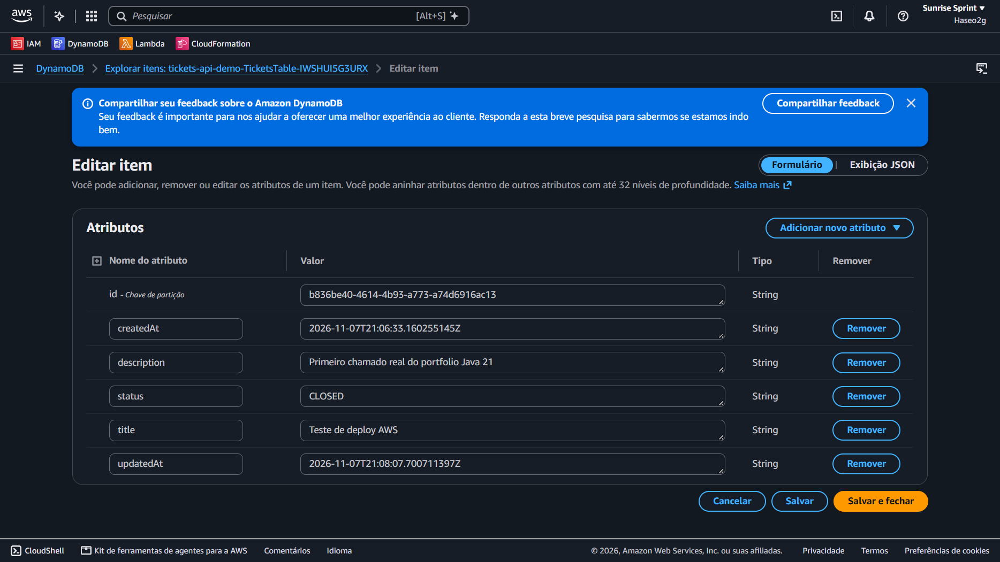
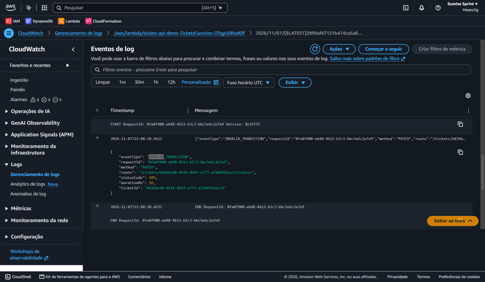
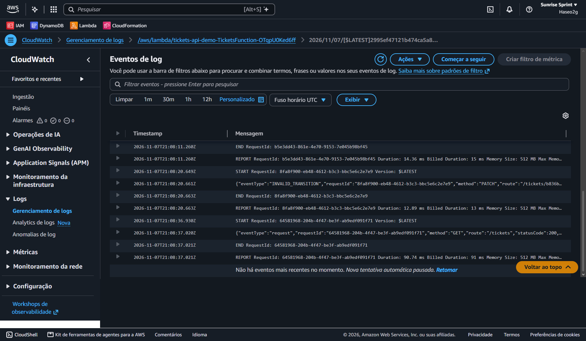

# Evidências da publicação e dos testes

Os resultados HTTP e o estado final do CloudFormation abaixo foram **informados pelo proprietário após testes manuais em 07/11/2026**. As três capturas recebidas nesta conversa foram copiadas sem alterações para `docs/images/`. A [execução de CI](https://github.com/Haseo2g/tickets-api-portfolio/actions/runs/42401517867) foi consultada no GitHub e consta como aprovada. Este registro não substitui o histórico de eventos da conta AWS.

## Infraestrutura informada

| Recurso | Valor |
|---|---|
| Conta e região | `161513061416`, `us-east-2` |
| Stack | `tickets-api-demo`; `UPDATE_COMPLETE` informado em 07/11/2026 às 18:03:32 (UTC−03:00) |
| API Gateway HTTP API | `https://k9okaxkcpg.execute-api.us-east-2.amazonaws.com` |
| Pacote S3 | `s3://haseo2g-tickets-api-artifacts-2026/tickets-api-lambda.zip` |
| Tabela DynamoDB | Prefixo `tickets-api-demo-TicketsTable-` |
| Grupo de logs | Prefixo `/aws/lambda/tickets-api-demo-TicketsFunction-` |
| Role de serviço CloudFormation | `TicketsApiCloudFormationDeployRole`; política `TicketsApiCloudFormationDeployRolePolicy` |

A role de serviço da stack é distinta da role de execução da Lambda criada pelo SAM. A publicação foi **manual pelo console CloudFormation**, após uma criação parcialmente bem-sucedida e uma operação de recuperação/atualização. Não houve deploy pelo GitHub Actions.

## Testes HTTP manuais informados

Base: `https://k9okaxkcpg.execute-api.us-east-2.amazonaws.com`. O chamado contém dados fictícios. A URL pode deixar de funcionar após a remoção da stack.

### Saúde

`GET /health` respondeu:

```json
{"status":"ok"}
```

### Criação e consulta

`POST /tickets` com `{"title":"Teste de deploy AWS","description":"Primeiro chamado real do portfolio Java 21"}` retornou:

```json
{
  "id": "b836be40-4614-4b93-a773-a74d6916ac13",
  "title": "Teste de deploy AWS",
  "description": "Primeiro chamado real do portfolio Java 21",
  "status": "OPEN",
  "createdAt": "2026-11-07T21:06:33.160255145Z",
  "updatedAt": "2026-11-07T21:06:33.160255145Z"
}
```

`GET /tickets/b836be40-4614-4b93-a773-a74d6916ac13` retornou o registro esperado. O proprietário testou `OPEN → IN_PROGRESS → CLOSED` por `PATCH /tickets/{id}/status`.

### Listagem

`GET /tickets?limit=10` retornou:

```json
{
  "items": [{
    "id": "b836be40-4614-4b93-a773-a74d6916ac13",
    "title": "Teste de deploy AWS",
    "description": "Primeiro chamado real do portfolio Java 21",
    "status": "CLOSED",
    "createdAt": "2026-11-07T21:06:33.160255145Z",
    "updatedAt": "2026-11-07T21:08:07.700711397Z"
  }],
  "nextToken": null
}
```

Uma lista com um item foi observada. **Paginação em múltiplas páginas ainda não foi verificada manualmente na AWS.**

### Transição proibida

Um `PATCH` de `CLOSED` para `OPEN` respondeu HTTP `409 Conflict`:

```json
{
  "error": {
    "requestId": "8fa8f900-eb48-4612-b3c3-bbc5e6c2e7e9",
    "message": "Transição de status não permitida",
    "code": "INVALID_TRANSITION"
  }
}
```

## DynamoDB e CloudWatch



*A captura mostra `id`, `title`, `description`, `status=CLOSED`, `createdAt` e `updatedAt` no console. A resposta HTTP de listagem acima mostra o mesmo registro fechado.*



O evento expandido mostra `eventType=INVALID_TRANSITION`, `method=PATCH`, `statusCode=409`, `durationMs=10` e o mesmo `requestId` da resposta HTTP. Essa correlação permite localizar a requisição sem registrar corpo completo ou descrição nos logs.



As linhas `START`, `END` e `REPORT` são da plataforma Lambda; os eventos JSON são da aplicação.

## Permissões ajustadas na implantação

Segundo o relato da implantação, erros de autorização levaram à inclusão de `cloudformation:CreateChangeSet` para o transform `Serverless-2016-10-31`, `apigateway:POST` para o recurso de tags da HTTP API e `apigateway:TagResource` para o stage. A terceira correção precedeu o `UPDATE_COMPLETE` informado. Esses ajustes dizem respeito à publicação da infraestrutura, não ao Java. A política foi criada manualmente na AWS; o JSON local anterior à publicação, ignorado pelo Git, **não é uma cópia confirmada da política final**.

## Evidências pendentes

- Print da CI aprovada; [link da execução](https://github.com/Haseo2g/tickets-api-portfolio/actions/runs/42401517867) já verificado.
- Print do CloudFormation mostrando `UPDATE_COMPLETE`.
- Prints das respostas HTTP reais de saúde, criação, consulta, listagem e erro.
- Print da execução reprovada do PR de demonstração; os links verificáveis estão abaixo.

Nenhuma das capturas acima mostra credenciais. O alias `Haseo2g` exibido na interface é o mesmo identificador público do repositório.

## Demonstração controlada de falha no CI

- Branch remota preservada: `demo/ci-failure`, commit `c552a86dd5d1849bd24e69f4e3489e736bd2f92a`.
- [PR #1 — Demo: CI detects intentional regression](https://github.com/Haseo2g/tickets-api-portfolio/pull/1): **CLOSED**, `mergedAt: null`; nenhuma alteração defeituosa entrou na `main`.
- [Execução do Actions disparada pelo PR](https://github.com/Haseo2g/tickets-api-portfolio/actions/runs/42420319459): workflow `CI`, job `verify`, conclusão `failure` no passo `bash ./mvnw -B verify`.
- Teste: `CiFailureDemoTest.demoCiDetectsWrongInitialStatusExpectation`. Mensagem real: `DEMO INTENCIONAL: expectativa errada para comprovar a reprovação do CI ==> expected: <CLOSED> but was: <OPEN>`. O log registrou **7 testes, 1 falha, 0 erros, 0 ignorados**; os 6 testes originais passaram.

O teste está apenas na branch de demonstração. Ele exige `CLOSED` para um chamado novo, embora a regra correta inicie em `OPEN`. A falha decorreu dessa asserção, não da infraestrutura ou das dependências. A execução reprovada e o PR permanecem consultáveis, mesmo após o fechamento sem merge.

**Limite da evidência:** em 07/11/2026, `GET /branches/main/protection` retornou `404 Branch not protected`, `GET /rulesets` retornou `[]` e `GET /rules/branches/main` retornou `[]` na API do GitHub. Não havia exigência de checks aprovados para merge na `main`. A demonstração mostra que o CI detectou o defeito e que o PR foi fechado por decisão consciente; não mostra um bloqueio técnico de merge. Nenhuma regra de proteção foi alterada.
